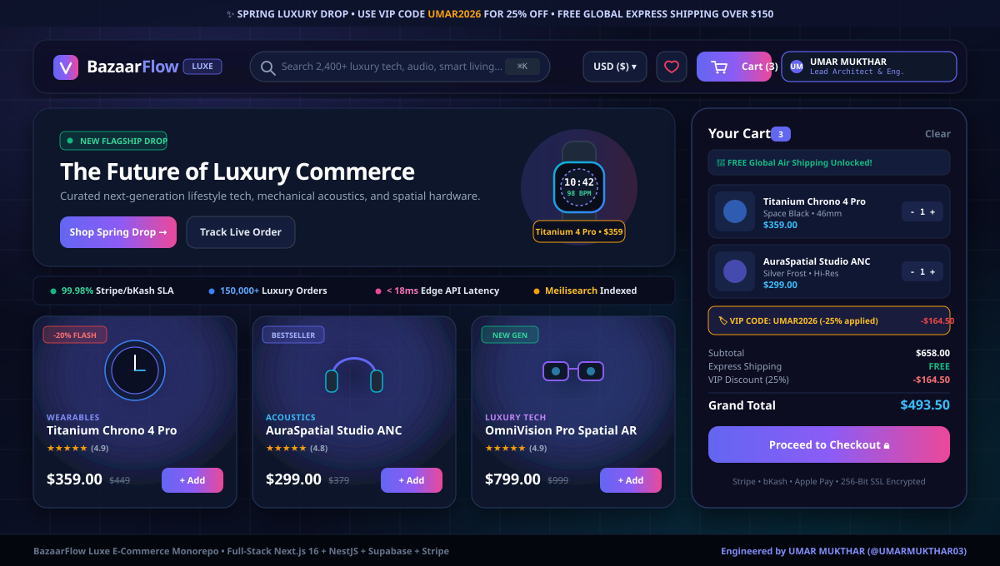
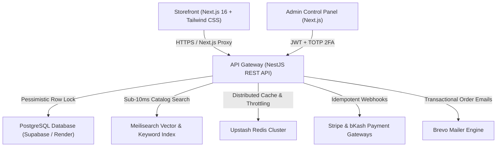

# 🛍️ BazaarFlow LUXE — Next-Gen Full-Stack E-Commerce & Luxury Retail Platform

[](https://github.com/UMARMUKTHAR03/ecommerce-platform/actions)
[](https://umarmukthar03.github.io/ecommerce-platform/)
[](https://nextjs.org/)
[](https://nestjs.com/)
[](https://react.dev/)
[](https://tailwindcss.com/)
[](https://stripe.com/)
[](https://supabase.com/)
[](https://redis.io/)
[](./LICENSE)
[](https://github.com/UMARMUKTHAR03)

> 🌐 **Interactive Frontend Prototype:** **[https://umarmukthar03.github.io/ecommerce-platform/](https://umarmukthar03.github.io/ecommerce-platform/)**  
> 📦 **Production Deployments:** Full-stack production deployment configured for **Vercel** (Next.js storefront & admin) and **Render** (NestJS backend API with PostgreSQL & Redis).

---

## 🖼️ Platform Preview

<div align="center">
  
</div>

---

## ⚡ Overview

**BazaarFlow LUXE** is an enterprise-grade full-stack e-commerce monorepo engineered for high-concurrency luxury commerce, authoritative financial calculations, transactional row locking, and omnichannel payments.

- 🛍️ **Customer Storefront & Admin Portal**: Built with Next.js 16 (App Router, Turbopack, React 19, Tailwind CSS v4) featuring responsive catalog discovery, variant selectors, multi-step checkout, and real-time order tracking.
- ⚙️ **Core Backend API**: Enterprise NestJS application with Helmet security headers, CORS origin whitelisting, Winston daily-rotate logging, class-validator sanitization, and TOTP two-factor authentication for admins.
- 💳 **Omnichannel Payment Engine**: Stripe Payment Intents with raw webhook signature validation and idempotent processing, alongside tokenized bKash checkout support.
- 🔒 **Database Integrity**: PostgreSQL managed with TypeORM migrations, foreign keys, cascade constraints, and row-level pessimistic locking (`pessimistic_write`) to guarantee zero overselling.
- ⚡ **Caching & Search**: Sub-10ms catalog querying via Meilisearch and distributed rate limiting with Upstash Redis.
- 📧 **Transactional Notifications**: Automated order confirmations and tracking updates via Brevo transactional email engine.

---

## 🏗️ System Architecture



---

## 📚 Technical Documentation

Complete architectural, operational, and deployment specifications:

| Guide | Description |
| :--- | :--- |
| 📐 [Architecture Specification](docs/ARCHITECTURE.md) | In-depth system design, database ER diagrams, and order lifecycle state machine. |
| 🚀 [Deployment Guide](docs/DEPLOYMENT_GUIDE.md) | Step-by-step deployment instructions for Vercel, Render, and Supabase. |
| 🔑 [Manual Setup & Credentials](docs/MANUAL_SETUP_REQUIRED.md) | Guide to external API keys, webhooks, and environment configuration. |
| 🧪 [Testing Guide](docs/TESTING.md) | Details on backend unit testing, frontend RTL tests, and CI/CD verification. |
| 🛡️ [Security Hardening](docs/SECURITY.md) | Cryptographic safeguards, TOTP 2FA, rate limiting, and row locking. |

---

## 🚀 Quickstart & Local Development

### Prerequisites
- Node.js 22.x or later
- npm 10.x or later
- PostgreSQL database instance

### 1. Installation
Clone the repository and install all monorepo dependencies:
```bash
git clone https://github.com/UMARMUKTHAR03/ecommerce-platform.git
cd ecommerce-platform
npm ci
```

### 2. Environment Configuration
Copy `.env.example` to `.env` in both `backend` and `frontend`:
```bash
cp .env.example backend/.env
cp .env.example frontend/.env.local
```

### 3. Run Automated Tests
```bash
# Run backend test suite (OrdersService, StripeService, AppController)
npm run test:backend

# Run frontend test suite (ProductCard, SearchBar, CartSummary)
npm run test --workspace frontend
```

### 4. Build Applications
```bash
# Compile NestJS backend
npm run build:backend

# Compile Next.js 16 frontend
npm run build:frontend
```

### 5. Launch Development Servers
```bash
# Start backend on http://localhost:3001
npm run start:dev --workspace backend

# Start frontend on http://localhost:3000
npm run dev --workspace frontend
```

---

## 🛡️ Order Lifecycle & Stock Protection

```
  [ Customer Cart ]
         │
         ▼ (Atomic Row-Locked Transaction)
    ┌─────────┐
    │ PENDING │ ◄─── (Stock decremented atomically; fails if stock < requested)
    └────┬────┘
         │
         ├───────────────────────────────────────┐
         │ (Stripe Webhook: payment_intent.succeeded)
         ▼                                       ▼ (Payment failed or Admin Cancelled)
     ┌──────┐                               ┌───────────┐
     │ PAID │                               │ CANCELLED │
     └───┬──┘                               └─────┬─────┘
         │                                        │
         ▼ (Fulfillment: RedX dispatch)           └───► (Stock automatically restored to catalog)
   ┌───────────┐
   │  SHIPPED  │
   └─────┬─────┘
         │
         ▼ (Delivered to customer)
   ┌───────────┐
   │ DELIVERED │
   └───────────┘
```

---

## 👤 Author

**Umar Mukthar**  
- GitHub: [@UMARMUKTHAR03](https://github.com/UMARMUKTHAR03)  
- Portfolio Projects: [ChurnIQ](https://github.com/UMARMUKTHAR03/churn-prediction), [OmniMind AI](https://github.com/UMARMUKTHAR03/rag-ai-chatbot), [Image Recognition Platform](https://github.com/UMARMUKTHAR03/image-recognition-app)

---

## 📄 License

This project is licensed under the MIT License — see the [LICENSE](LICENSE) file for details.
