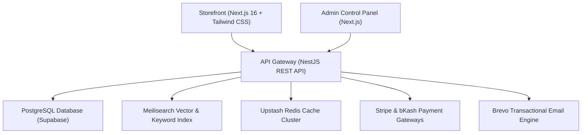

# 🛍️ BazaarFlow — Next-Gen Full-Stack E-Commerce Monorepo & Luxury Commerce Platform

[](https://umarmukthar03.github.io/ecommerce-platform/)
[](https://nextjs.org/)
[](https://nestjs.com/)
[](https://react.dev/)
[](https://tailwindcss.com/)
[](https://stripe.com/)
[](https://www.meilisearch.com/)
[](https://redis.io/)
[](https://supabase.com/)
[](./LICENSE)
[](https://github.com/UMARMUKTHAR03)

---

## 🖼️ Visual Platform Preview

<div align="center">
  
</div>

---

## ⚡ Overview

**BazaarFlow** is an enterprise-grade, high-conversion full-stack e-commerce monorepo architected for speed, modern payment flexibility, and seamless omnichannel shopping experiences.

- 🛍️ **Storefront**: Next.js 16 App Router + React 19 + Tailwind CSS v4 client-side rendering with instant search, multi-currency conversion, live cart telemetry, and interactive checkout.
- ⚙️ **API Engine**: Modular NestJS backend running on Node.js with TypeScript, structured logging, JWT + HTTP-only cookies, and rate-limiting guards.
- 💳 **Omnichannel Payments**: Native Stripe Payment Intents & Webhooks alongside bKash mobile payment verification.
- ⚡ **Instant Search**: Sub-10ms catalog querying powered by Meilisearch with automatic PostgreSQL database fallback.
- 🗄️ **Data & Caching**: PostgreSQL (Supabase) relational storage paired with Upstash Redis low-latency caching layers.

---

## 🏗️ System Architecture



---

## 🌟 Key Capabilities

### 1. Customer Shopping Experience
- **Dynamic Category & Search Discovery**: Real-time faceted filtering by category, price bounds, rating thresholds, and stock status.
- **Interactive Product Quick-View Modal**: Multi-angle image carousels, dynamic color swatch selectors, storage/size variant selectors, and live stock countdowns.
- **Interactive Slide-Out Cart Drawer**: Real-time quantity adjustments, free shipping progress tracker ($150 threshold), and instant promo code validation (`UMAR2026` for 25% VIP discount, `BAZAAR10` for 10% discount).
- **Multi-Step Checkout Studio**:
  - **Shipping**: Structured address validation & courier tier selection.
  - **Payment**: Interactive 3D-styled Credit Card simulator with real-time cardholder and CVV flip animations, alongside Stripe, bKash, and Apple Pay simulation.
  - **Fulfillment**: Instant Order ID generation, itemized digital invoice, and live delivery timeline tracker.
- **Global Currency Engine**: Instant on-the-fly currency conversion between **USD ($)**, **EUR (€)**, **GBP (£)**, and **INR (₹)**.
- **Live Order Tracking**: Lookup orders by reference ID to visualize live tracking milestones (*Placed* → *Verified* → *Dispatched* → *Out for Delivery*).

### 2. Admin & Store Operations
- **Role-Based Access Control**: Multi-factor authentication with TOTP 2FA.
- **Catalog Management**: Deep product CRUD with image uploads, category tree hierarchies, and inventory restock triggers.
- **Fulfillment Engine**: Order lifecycle tracking (*Pending*, *Processing*, *Shipped*, *Delivered*, *Cancelled*).
- **Marketing & Promotions**: Dynamic percentage and fixed-value coupon creation with usage caps and expiry dates.

---

## 📁 Monorepo Workspace Structure

```
ecommerce-platform/
├── .github/                 # CI/CD Workflows
├── backend/                 # NestJS Core API Engine
│   ├── src/                 # Controllers, Services, Guards, Entities
│   ├── test/                # E2E and Unit Test Suites
│   └── Dockerfile           # Production Container Definition
├── frontend/                # Next.js 16 Storefront & Admin Portal
│   ├── src/app/             # App Router Pages & Layouts
│   ├── src/components/      # UI Design System & Component Library
│   ├── src/context/         # Cart, Auth, and Theme Providers
│   └── public/              # Static Assets & Icons
├── shared/                  # Shared TypeScript DTOs & Interfaces
│   └── types/index.ts       # Product, Category, Order, Cart schemas
├── docs/                    # In-repo Previews & Setup Guides
│   └── preview.svg          # High-Resolution Platform Preview
├── LICENSE                  # MIT License (c) 2026 UMAR MUKTHAR
├── index.html               # Live Client-Side Interactive Web Studio
└── README.md                # Master Monorepo Documentation
```

---

## 🚀 Quickstart Guide

### Prerequisites
- Node.js `>= 20.x`
- npm `>= 10.x`
- Docker (optional, for local PostgreSQL & Meilisearch)

### Installation
Clone the repository and install all workspace dependencies:

```bash
git clone https://github.com/UMARMUKTHAR03/ecommerce-platform.git
cd ecommerce-platform
npm install
```

### Running Locally

```bash
# Run both Frontend and Backend concurrently
npm run dev:frontend    # Starts Next.js storefront on http://localhost:3000
npm run dev:backend     # Starts NestJS API on http://localhost:4000
```

### Running Tests

```bash
npm run test:backend    # Runs NestJS Jest unit & integration tests
npm run lint:frontend   # Runs ESLint checks across frontend code
```

---

## ⚙️ Environment Variables

Copy `.env.example` to `.env` in both `frontend` and `backend` directories:

| Variable | Description |
| :--- | :--- |
| `DATABASE_URL` | PostgreSQL connection URI (Supabase) |
| `UPSTASH_REDIS_URL` | Redis cache connection string |
| `MEILISEARCH_URL` | Search engine host URL (default `http://localhost:7700`) |
| `MEILISEARCH_API_KEY` | Master/Search API key for Meilisearch |
| `STRIPE_SECRET_KEY` | Stripe backend payment secret |
| `STRIPE_WEBHOOK_SECRET` | Secret for verifying incoming Stripe webhooks |
| `JWT_SECRET` | Signing key for customer and admin session tokens |

---

## 🔒 Security & Performance Features

- **Rate Limiting**: Throttler guards protecting authentication and checkout endpoints.
- **Secure Cookies**: HTTP-only, SameSite=Strict cookies for refresh tokens.
- **Cache Strategy**: Key-based cache invalidation on catalog mutations.
- **Safe SQL**: Prisma / TypeORM parameterized queries preventing SQL injection.

---

## 📄 License & Attribution

This project is licensed under the **MIT License** — see the [LICENSE](./LICENSE) file for complete details.

**Architected & Maintained by [UMAR MUKTHAR](https://github.com/UMARMUKTHAR03)**  
*Lead AI & Full-Stack Systems Engineer* • [umarom98425@gmail.com](mailto:umarom98425@gmail.com)  
*Copyright (c) 2026 UMAR MUKTHAR. All rights reserved.*
